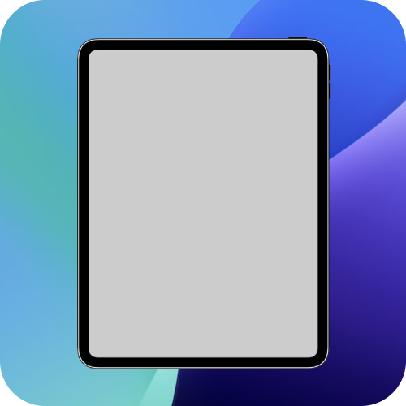
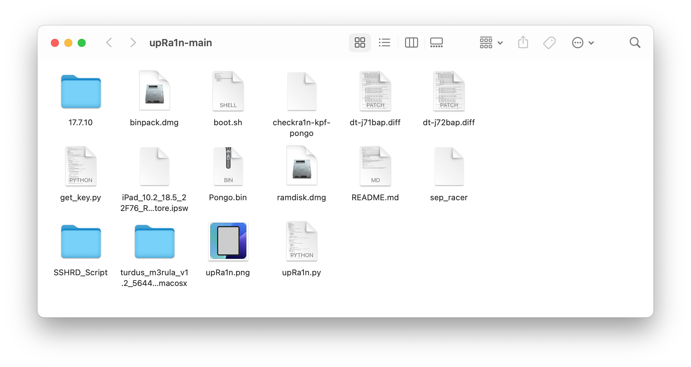

# upRa1n
Tethered dualboot/restore iOS 18 on iPad 6 (Wi-Fi / Cellular)

## Description
Tethered dualboot/restore of iOS 18 on iPad 6 (Wi-Fi and Cellular models). 

The device **must already be running iOS 17.7.10 or iOS 17.7.11.** (if you are using iPad 6 Cellular, this WONT WORK ON IOS 17.7.11, use 17.7.10)

**Important:** This script only works on macOS (Intel/Apple Sillicon) (tested on macOS Monterey on a MacBook Pro 15" 2015, Apple Sillicon Mac with macOS Tahoe, Intel Mac with macOS Sonoma). If you have an iPad 6 Cellular, activate it before performing the dualboot.

## Credits

- **asdfugil (Nick Chan) for the original installation guide** (https://github.com/asdfugil/ipad6-ipados18).
- **verygenericname (Nathan) for SSHRD Script** (https://github.com/verygenericname/SSHRD_Script).
- **kok3shidoll, Clarity, Mineek for turdusra1n** (https://sep.lol).
- **Mineek, Nick Chan, Samara, HAHALOSAH for palera1n** (https://palera.in)
- **crystall1nedev for SSV patch (https://github.com/crystall1nedev/ipad6-ipados18/tree/ssv-patch)**

## Our discord server

https://discord.gg/dWWJx5gX

## Dependencies
You must install and compile the following dependencies and copy their executables to `/usr/local/bin/` (using `make` or `./autogen.sh`):

> [!TIP]
> The compiled dependencies (for intel mac) are in Releases. But I HIGHLY recommend compiling them manually

- **aea** – https://github.com/dhinakg/aeota/tree/53e461d9788744bdd107e7d2043d71625324a682
- **iBootpatch2** – https://github.com/crystall1nedev/ipad6-ipados18/tree/ssv-patch
- **img4lib** – https://github.com/xerub/img4lib/tree/69772c72f3c08f021ec9fa4c386f2b3df60a38b7
- **devicetree-parse and devicetree-repack** – https://github.com/khanhduytran0/devicetree-parse.git
- **palera1n** – https://palera.in
- **homebrew** – https://brew.sh
- **Python 3** – https://python.org
- **libimobiledevice (iproxy)** – ``brew install libimobiledevice``
- **libirecovery** - ``brew install libirecovery``
- **pongoterm** - https://github.com/palera1n/PongoOS/blob/iOS15/scripts/pongoterm.c

## Usage

```bash
Usage: python3 upRa1n.py <options>

Commands:

   restore               Tethered restore
   boot                  Boot your iPad
   dualboot              Tethered dualboot

Example:

   python3 upRa1n.py restore
   python3 upRa1n.py boot

```

## Installation

1. Install all dependencies listed above.
2. Clone this repository.
3. Download:
   - iOS 18 firmware (any version) for **iPad 7** (Wi‑Fi or Cellular, depending on your model).
   - iOS 17.7.10 (or .11) firmware for **iPad 6** (Wi‑Fi or Cellular, matching your device).
4. Place the iOS 18 firmware file in the same directory as `upRa1n.py`.
5. Extract the iOS 17.7.10 (.11) firmware into a folder named `17.7.10/ (17.7.11/)`.
6. Install required Python packages:
   ```bash
   pip3 install colorama art paramiko tqdm scp requests pyhpke
   ```
7. Download SSHRD Script
   ```bash
   cd upRa1n
   git clone https://github.com/verygenericname/SSHRD_Script.git
   ```
9. Download the latest version of turdus_merula and **rename the unzipped folder to turdus_merula**
8. Run the script:
   ```bash
   cd upRa1n
   python3 upRa1n.py restore (or dualboot)
   ```
8. Follow the on‑screen instructions in the terminal.

The `upRa1n` folder should look like this after completing all the steps:



## Known issues

- ### Black wallpaper
Solution:

Set iOS 18 wallpaper in Settings after connecting to Wi-Fi


- ### Poor performance
Solution:

Run this script on device

https://github.com/flylarb/iOS-Performance-Tweaks/releases/tag/1
